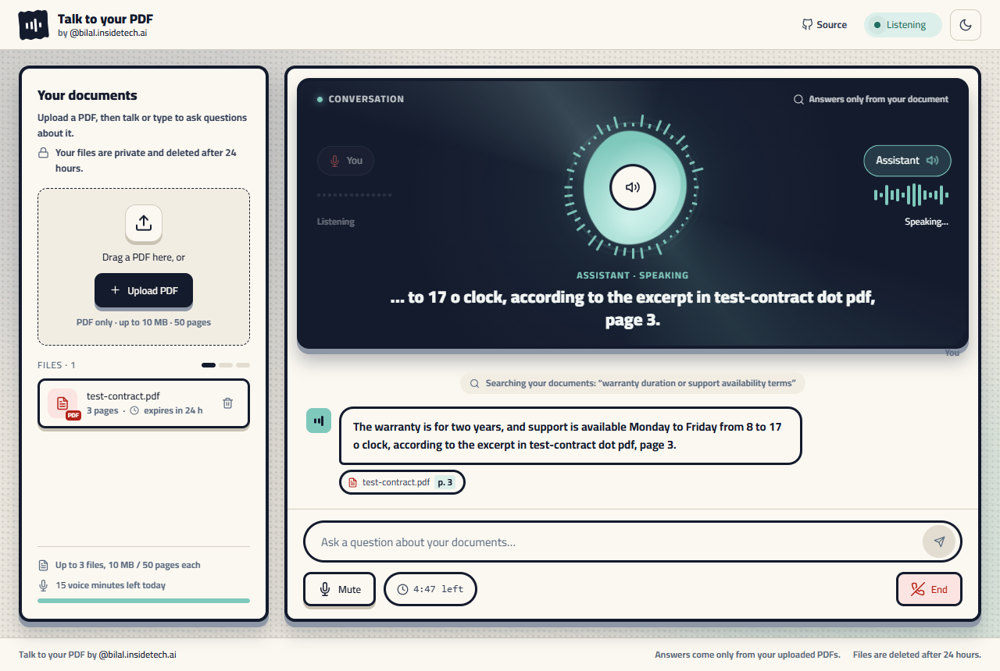

# Talk to your PDF

Upload a PDF, then ask questions out loud or by typing. The answer comes only from your file
and names the page it found it on.

**Live demo:** [abulabn.de/pdf](https://abulabn.de/pdf) · Built for the
[Inside Tech](https://www.instagram.com/bilal.insidetech.ai/) series, where I explain how
RAG works and build this app step by step.



## What it does

- Up to 3 PDFs per visitor (10 MB and 50 pages each), deleted after 24 hours
- **Voice:** a real-time conversation over WebRTC (OpenAI Realtime API)
- **Text:** streamed answers, with follow-up questions
- Every answer cites file and page, and voice and text share one transcript
- Answers in the language you speak or write (English, German, Arabic and more)
- Cost protection for a public deployment: daily budget, per-IP limits, call length limit

## How it works

```
PDF ──▶ text per page ──▶ chunks ──▶ embeddings ──▶ stored per visitor
                            │
question ──▶ keyword search (BM25) ─┐
         └─▶ vector search ─────────┴─▶ rank fusion ──▶ top 5 excerpts ──▶ model ──▶ answer + page
```

**Chunking** (`server/core/rag/chunk.ts`): each page is split into sentences (Latin, Arabic and
CJK punctuation), and sentences are packed into chunks of up to 1000 characters with about 150
characters of overlap. A chunk never crosses a page break, so every excerpt belongs to exactly one
page and the citation is exact. The document name is embedded together with each chunk.

**Search** (`server/core/rag/hybrid.ts`): keyword search (Okapi BM25) finds exact terms such as
invoice numbers, vector search finds passages with the same meaning in other words. Reciprocal rank
fusion merges both lists.

**Voice** (`server/apps/pdf_voice/calls.ts`): the browser talks to the OpenAI Realtime API directly
over WebRTC, but the API key never reaches the browser. The server creates the call and keeps a
second connection to the same session (the sideband). There it answers the model's
`search_documents` tool calls with excerpts from your PDFs, counts the cost and ends the call at
the time limit.

**Text** (`POST /v1/pdf/chat`): the server searches first, then streams the answer as server-sent
events (`search`, `source`, `token`, `done`). The full API is in [docs/api.md](docs/api.md).

## Run it locally

You need Node.js 22 or newer and an OpenAI API key with access to the Realtime API.

```bash
git clone https://github.com/BelalAbulabn/talk-to-your-pdf.git
cd talk-to-your-pdf

# API on http://localhost:4000
cd server
cp .env.example .env   # set OPENAI_API_KEY
npm install
npm run dev

# app on http://localhost:3000 (second terminal)
cd web
cp .env.example .env.local
npm install
npm run dev
```

Open http://localhost:3000, upload a PDF and press **Start conversation**. The browser asks for
the microphone once.

### With Docker

```bash
cp server/.env.example server/.env   # set OPENAI_API_KEY
docker compose up -d --build
```

The app runs on http://localhost:3000, the API on http://localhost:4000.

## Configuration

All settings live in `server/.env` (see `server/.env.example` for every option):

| Variable                       | Default                  | Meaning                                    |
| ------------------------------ | ------------------------ | ------------------------------------------ |
| `OPENAI_API_KEY`               |                          | Required. Stays on the server.             |
| `WEB_ORIGIN`                   | `http://localhost:3000`  | Origins of the web app, comma-separated    |
| `REALTIME_MODEL`               | `gpt-realtime-2.1-mini`  | Voice model                                |
| `REALTIME_VOICE`               | `marin`                  | Voice                                      |
| `CHAT_MODEL`                   | `gpt-5.4-mini`           | Model for text answers                     |
| `EMBEDDING_MODEL`              | `text-embedding-3-small` | Embeddings for vector search               |
| `DAILY_BUDGET_USD`             | `10`                     | The service stops for the day at this cost |
| `MAX_CALL_MINUTES`             | `5`                      | Length of one voice call                   |
| `VOICE_MINUTES_PER_IP_PER_DAY` | `15`                     | Voice minutes per visitor and day          |
| `MAX_DOCS_PER_VISITOR`         | `3`                      | Files per visitor                          |
| `DOC_TTL_HOURS`                | `24`                     | Files are deleted after this time          |

The web app needs only `NEXT_PUBLIC_API_URL`, the public address of the API.

## Putting it online

- Serve both over HTTPS. Put the app and the API on the same domain
  (`pdf.example.com` and `api.example.com`) so the session cookie works with the default
  `COOKIE_SAMESITE=lax`. For different domains set `COOKIE_SAMESITE=none`.
- Behind nginx or Caddy, set `TRUST_PROXY=true` so the per-IP limits see the real visitor.
- Build the web app with the public API address:
  `PUBLIC_API_URL=https://api.example.com docker compose up -d --build`
- Start with a small `DAILY_BUDGET_USD`.

## Project structure

```
server/
  core/             config, errors, cost tracking
  core/rag/         PDF text, chunking, embeddings, hybrid search, document store
  apps/pdf_voice/   voice calls (WebRTC + sideband), text chat, events, routes
  api/              HTTP server (Hono): CORS, origin check, errors
web/                Next.js app: upload, voice stage, transcript, text input
docs/api.md         HTTP API contract
```

## Tests

```bash
cd server
npm test
```

## License

[MIT](LICENSE) © 2026 Belal Abulabn
